# verify — evidence-gated verification for agent-produced changes

[](https://github.com/Gamebreack/agent-verification/releases)
[](LICENSE)
[](https://github.com/Gamebreack/agent-verification/actions/workflows/validate.yml)

`verify` is an Agent Skill that checks a change against what it was supposed to do. You give it the change and the task behind it. It builds a contract from that task, has fresh reviewers check the change against it, and returns a verdict backed by evidence. It never fixes anything. Passing tests and reviewer agreement are evidence to inspect, not proof.

## What you get

- **A contract from the original task**, built before any reviewer starts and never edited. Optionally supply your own with `--contract`.
- **A small panel chosen by risk**: only the reviewers the changed surface calls for, each in a clean context.
- **Evidence-gated adjudication**: every claim is checked and severity is earned, so speculation does not block a ship.
- **A fixed report**: the same header every time, one of four verdicts, executed and static evidence labelled.
- **Read-only, with a re-check loop**: you fix, then `verify` again and it confirms each earlier finding.

## How it works

You invoke `verify` on a change. It resolves the target, builds the contract, selects and briefs reviewers, adjudicates their findings, and reports. After `FIX REQUIRED` you fix the change and re-run; the re-check looks at what changed and what was still open. Full flow: [flow-map.md](flow-map.md).

```mermaid
%%{init: {"theme":"base","themeVariables":{"fontFamily":"system-ui, -apple-system, Segoe UI, sans-serif","fontSize":"15px","primaryTextColor":"#1b221e","lineColor":"#8a968f","clusterBkg":"transparent","clusterBorder":"#b7c0ba","titleColor":"#5d6962","edgeLabelBackground":"#ffffff"},"flowchart":{"curve":"basis","nodeSpacing":22,"rankSpacing":30,"padding":14,"htmlLabels":true}}}%%
flowchart LR
    T["<b>Target</b><br/>the change"]
    C["<b>Contract</b><br/>from the task"]
    P["<b>Panel</b><br/>fresh reviewers"]
    J["<b>Adjudication</b><br/>claims gated"]
    V["<b>Verdict</b><br/>and report"]
    Z["<b>Author fixes</b><br/>verify never repairs"]

    T --> C --> P --> J --> V
    V -->|"FIX REQUIRED"| Z
    Z -->|"re-check"| P

    classDef ext fill:#e7eae8,stroke:#8a968f,color:#1b221e
    classDef p1 fill:#dbe8f6,stroke:#4a7fb5,color:#1b221e
    classDef p2 fill:#fbefd2,stroke:#c3962c,color:#1b221e
    classDef p3 fill:#d8eee2,stroke:#3f8f68,color:#1b221e
    class T,C p1
    class P p2
    class J,V p3
    class Z ext
    linkStyle 4,5 stroke:#7a5aa6,stroke-width:1.5px
```



## What a report looks like

Every report opens with this header (an illustrative example; the template lives in [adjudication.md](.agents/skills/verify/references/adjudication.md#markdown-report)):

```markdown
# Verification: FIX REQUIRED
Target: branch feature/retry-payments against main, plus working tree
Assurance: independent panel
Evidence: executed unit tests, by the lead (pass); static handler and queue code, by reviewers; not run integration suite — no test database available
Scope: covered 4 changed files; not covered staged content that differs from the working tree
Verified state: 3f9c2a1 8d41e07b5c
```

## Reviewer roles

Exactly five; the panel includes only those a concrete trigger calls for. Baselines, triggers and bounds: [panel.md](.agents/skills/verify/references/panel.md).

| Role | Checks | Joins when |
|---|---|---|
| `acceptance` | the change does what the task asked | always |
| `tests` | tests exist, are right, and would catch a failure | always |
| `regression` | existing behavior and consumers still work | shared or persisted surface changed (always in `release`) |
| `invariants` | ranges, ordering, state, retries, idempotency hold | the contract states such a rule |
| `security` | authorization, secrets, trust boundaries | an auth or sensitive surface changed |

## Verdicts

Rules: [adjudication.md](.agents/skills/verify/references/adjudication.md#verdict-rules).

| Verdict | Meaning |
|---|---|
| `PASS` | no validated finding blocks the change |
| `PASS WITH NOTES` | shippable, with notes or evidence gaps to read |
| `FIX REQUIRED` | a validated blocking defect or missed requirement; do not ship until a re-check passes |
| `INCONCLUSIVE` | essential evidence is unavailable or the source of truth is ambiguous |

## Modes

| Mode | Baseline | Maximum |
|---|---|---|
| `quick` | acceptance and tests in one reviewer context | no extra roles; escalates to `panel` on a security trigger or high-risk surface |
| `panel` (default) | acceptance and tests, plus triggered roles | bounded; escalates to `release` on a critical surface |
| `release` | acceptance, tests and regression, plus triggered roles | all five roles |

## Quick start

Install: [docs/installation.md](docs/installation.md) lists every host's discovery path. For one user, symlink the skill, for example `ln -s "$PWD/.agents/skills/verify" ~/.agents/skills/verify`, and restart the host.

```text
verify [quick|panel|release] [target] [--contract <path>] [--report markdown|json]
```

```text
verify                               # the current branch and working tree, panel mode
verify quick                         # a small, low-risk change
verify release v1.2.0..HEAD --contract docs/task.md
```

Target and base resolution rules: [SKILL.md](.agents/skills/verify/SKILL.md).

## Evidence

- **Structural validation** is deterministic and needs no model: `python3 scripts/eval_harness.py validate` and `python3 -m unittest discover -s tests` check the skill package, materialize every fixture as a real Git repository and test the scorer. They prove the package is well-formed, not that a model behaves well.
- **Behavioral runs** need a model host, because the skill is run by an agent. Latest records: [OpenCode](evals/runs/2026-11-11-opencode.json) and [Claude Code](evals/runs/2026-11-11-claude-code.json). What they do and do not show: [assurance boundary](docs/evaluation.md#assurance-boundary).

## Documentation

[Architecture](docs/architecture.md) · [Flow map](flow-map.md) · [Installation](docs/installation.md) · [Behavioral evaluation](docs/evaluation.md) · [Contributing](CONTRIBUTING.md) · [Changelog](CHANGELOG.md)

## License

Released under the [MIT License](LICENSE).
