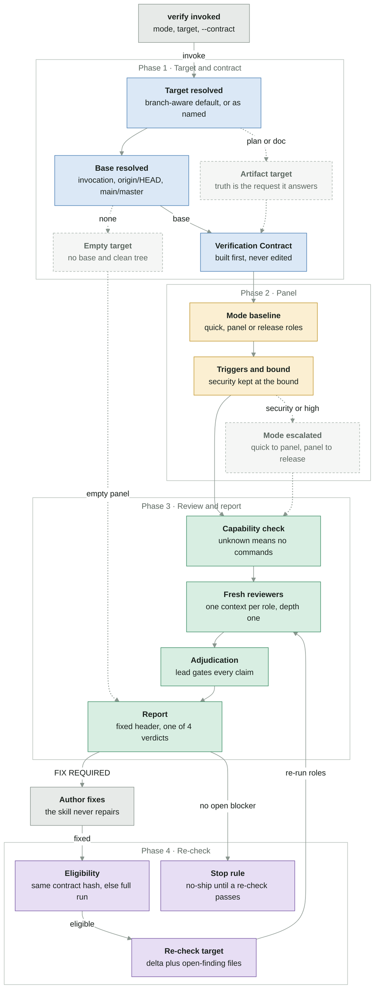
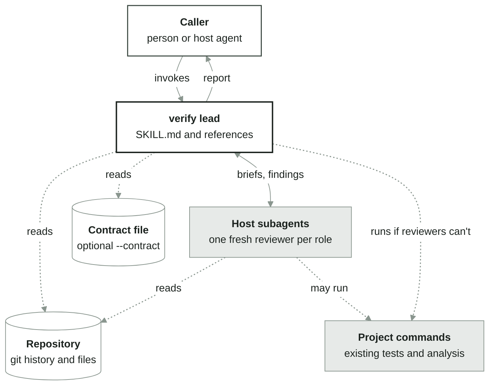
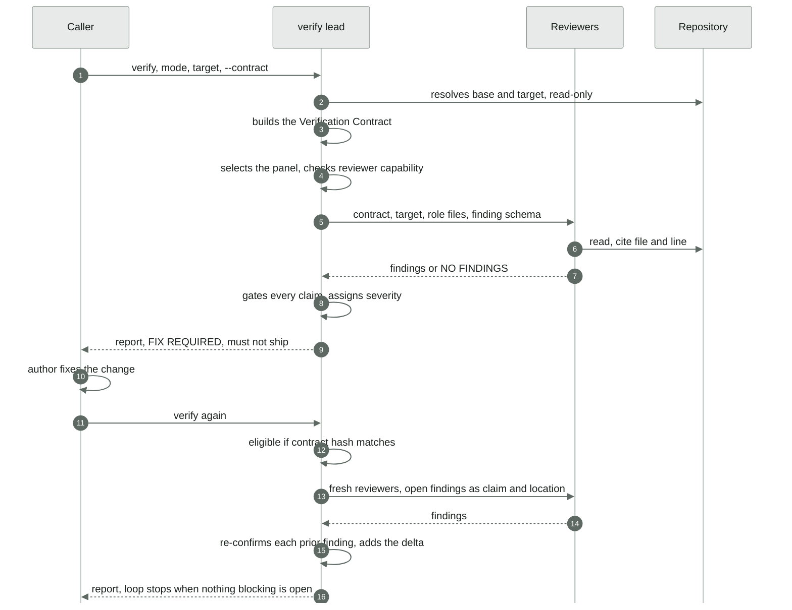

# Flow map — from the verify request to the verdict

The runtime flow of the `verify` skill, from the invocation (A) to the report and the re-check loop after `FIX REQUIRED` (B). This is the single home of the runtime flow diagram; the rules behind each step live in `.agents/skills/verify/SKILL.md` and `references/`.

Renders on GitHub and claude.ai; VS Code needs a Mermaid extension.

> **Status:** draft — not reviewed (no fresh reviewer was available; every box was checked against the sources by the author only). Everything shown exists in the skill's text. Nothing is missing. The skill is a set of instructions run by the host's agent, so "exists" means the step is specified in the skill files; the flow is not code.
> Lines: solid = exists · red dashed or red band = missing · dotted = optional or read-only · "no code yet" (or "not described") box = missing stage · grey = outside the target · light grey dashed box = side path

## 1. What happens

| Phase | In one line |
|---|---|
| Target and contract | The default target is the branch against its merge base plus the working tree, or the working-tree diff; the base comes from the invocation, then `origin/HEAD`, then local `main` or `master`, else the working tree only (and an empty target reviews nothing, `PASS WITH NOTES`). A plan or design document is an artifact target whose truth is the request it answers. The Verification Contract is built before any reviewer and is never edited or reinterpreted. |
| Panel | The mode baseline plus roles added only by concrete surface trigger, up to the mode maximum. A triggered security role is never the one omitted; `quick` escalates to `panel` on a security trigger or a high or critical surface, and `panel` to `release` on a critical one. |
| Review and report | The lead checks whether reviewers can run commands (if not, it runs the narrow read-only commands itself), dispatches fresh reviewers, gates every claim, and returns one of `PASS`, `PASS WITH NOTES`, `FIX REQUIRED`, `INCONCLUSIVE` under the fixed header. Without fresh contexts the roles run in sequence and the report says `degraded independence`. |
| Re-check | After `FIX REQUIRED` and a fix, a re-check is eligible only for the same contract with an unchanged source (compared by hash); otherwise a full run follows. It re-runs the baseline roles, every role with an open finding and any newly triggered role, over the delta (commits since the verified state, working-tree status, paths whose hash changed) plus the files of open `BLOCKER` and `SHOULD_FIX` findings. It stops at the first round with no new or unresolved blocking finding and no `MISSING` gap; `OPTIONAL` findings never open another round. |

## 2. Who talks to whom

The caller invokes the lead, which reads the repository and the contract file and briefs host subagents; reviewers read the repository and may run existing project commands. Colors here only tell who is who.

## 3. The life of one verification

## Where it lives

| Phase | Path |
|---|---|
| Target and contract | `.agents/skills/verify/SKILL.md` (steps 1–2), `.agents/skills/verify/references/verification-contract.md` |
| Panel | `.agents/skills/verify/references/panel.md` |
| Review and report | `.agents/skills/verify/SKILL.md` (steps 4–6), `.agents/skills/verify/references/reviewers/`, `.agents/skills/verify/references/adjudication.md`, `.agents/skills/verify/references/json-report.md` |
| Re-check | `.agents/skills/verify/SKILL.md` (step 7), `.agents/skills/verify/references/adjudication.md#re-check`, `.agents/skills/verify/references/panel.md#re-check-panel` |

When the flow changes, the map changes in the same PR. To update, see what changed since the commit below.

Updated 2026-11-11 · agent-verification release/v0.5.0 2d6c68e
